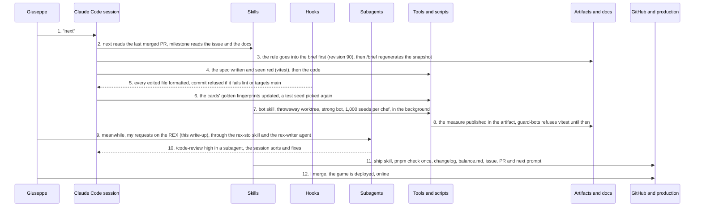

The bet fit in one sentence: a single human plays the Product Owner, the reviewer and the tester, and **the agent writes all the code**. Not one line from me. The question wasn't "*can AI code*" (we know it can), but: does it hold up on a real product, for more than three days, without quality collapsing? And above all, what organization it takes around it to make it hold.

The product is *Salade Tomate Oignon* (lettuce, tomato, onion: what you answer at a French kebab counter when asked what goes in), a deckbuilder roguelite in the browser where you take over a declining kebab shop. It served as my running thread; it is not the subject. The subject is **everything around the code**: the brief, the rules, the skills, the hooks, the PR procedures. What I call, as in a kitchen, the *mise en place*.

The figures, read in the repository on 26 October:

- 9 days, from 18 to 26 October 2026;
- 93 merged pull requests;
- 571 commits on `main`;
- 1,087 tests in 98 spec files;
- 18,377 lines of TypeScript outside tests, and 16,856 lines of tests;
- 88 Claude Code sessions.

Nothing is rounded up, except my ego. The game has been online since day three, in French, English and Italian, and it stays private: you'll only get screenshots.

<Figure src="{BASE_URL}/imgs/articles/2026-10-27-workflow-claude-code-kebab-roguelite/service.png" alt="The game's service screen in pixel art, night theme: the customer Nadia, her contract on display, a hand of six ingredient cards and the kebab in progress" caption="The service, night theme. Nadia's train leaves in four minutes." />

## A kebab, with the rules written in black and white

The game in five lines. A *run* is three districts of eight nodes. A "service" node queues three to five customers; for each one, you build a kebab from a hand of six ingredient cards (bread required, then meat, toppings, sauces, an extra) and serve it against the customer's *contract*: a threshold, firm demands, preferred tags, patience. *Rent* is due at the end of each district. Reputation at zero or unpaid rent: curtains.

**Three choices make it this game**: the *spit* is the run's health (each meat card eats a slice), the customer is a readable contract (nothing hidden, the difficulty comes from the hand), and rent is the economic boss.

The constraints I set myself:

- *mobile first* at 360 px, playable with a thumb, no required hover;
- initial *bundle* under 250 kB gzipped;
- no network requests in play;
- no CSS framework, no account, no external API;
- full keyboard, AA contrast, `prefers-reduced-motion` respected.

And a language rule: **the game speaks French, the code speaks English**. The stack, chosen before the first line: React 19, strict TypeScript, Vite, Zustand, Motion, Vitest, ESLint and Prettier, GitHub Actions.

All of this lives in one document, "*Kebab Roguelite — Brief de jeu*" (the game brief): pitch, loop, numbered rules, content, stack, open questions. **It is the source of truth.** The repository only reads a generated snapshot of it, `docs/brief.md`, with its revision number at the top (90 today); a `/brief` command regenerates it. A rule changes in the brief first, then in the code, *never the other way round*.

And the brief contains a worked example, a customer named Karim served for a score of 15: **that is the reference regression test**. When the scoring model changed on 23 October, the decision was "*Karim stays at 15*", and the test stayed the judge.

<Figure src="{BASE_URL}/imgs/articles/2026-10-27-workflow-claude-code-kebab-roguelite/map.png" alt="A district map in pixel art: eight rows of nodes linked by paths, the boss at the top, then the rent" caption="A district map: 8 rows, the boss, then the rent." />

## The mise en place: writing down what a colleague would have guessed

The principle is simple: **the agent codes, I decide**. For that to work, I had to write down in black and white everything a human colleague would have guessed in two days of *pair programming*. Here are the pieces, in the order they arrived.

**The brief and its snapshot.** I've just covered it. What matters is that an agent starting from scratch at every session needs a text that **only moves by decision**. Without it, it "fixes" the game towards what it believes the game should be.

**The glossary.** `docs/glossaire.md`: a French term, an English identifier, a meaning. An engine function whose name isn't in it gets renamed, or the glossary grows first. Without the table, each session invents its own word (`queue` or `line`, `district` or `neighborhood`) and **the code fills up with synonyms**. It now has 471 lines, an English column and an Italian one: it served as the lexicon when the game was translated.

**A short `CLAUDE.md`.** It is the file the agent reads at every session. Mine doesn't describe the code (the code says it better): it says **where the truth is and what the code can't tell**. An excerpt, verbatim:

```md
Topic rules live in `.claude/rules/` and load when you touch matching files (engine and content,
components and styles, stores, tests, CI). Don't inventory the code here or there: write only what
the code can't tell.

- **Words:** `docs/glossaire.md` maps each French term to its one English identifier. An engine
  function whose name isn't in it gets renamed, or the glossary grows first.
- **Balance:** `docs/balance.md` logs every value change (date, before, after, why).
```

**Rules per folder.** Five files in `.claude/rules/`, read only when the agent touches the files they target:

- the engine is a pure, seeded reducer, content is data;
- stores carry no game rule;
- components read selectors;
- the spec is written first and shown red;
- CI does what `pnpm check` does, in one job.

**TDD enforced, not suggested.** The spec first, shown red, then the code. Every numbered rule of the brief has a test named after it. 90% coverage required on the engine since day 1, never lowered. The red shown before the code is the only proof that the test tests something, and that is even truer with an agent: **the test is the only specification it cannot interpret**.

**Skills.** Procedures live in `.claude/skills/`, not in my head.

- `/milestone N` lands the merged PR and starts the next one;
- `/next` reads the last PR to know what to do;
- `/ship` re-reads the diff with `/code-review`, runs the full check only once, updates the changelog, ticks the issue's boxes and opens the PR;
- `/brief` regenerates the snapshot;
- `/bot` measures the balance.

A procedure in a file **gets fixed once for every session**; a reminder in a prompt is forgotten by the third one.

**Hooks.** Five guardrails **run by the tool, not by goodwill**:

- format and lint every edited file;
- refuse a commit on `main`, a push to it and any *force push*;
- refuse a commit whose files fail Prettier or ESLint;
- refuse the full check, vitest and the screenshots while a balance bot is running;
- and say at the start of every session what is already running.

**The next session's prompt.** Every PR ends with a block of text that the next session copies and pastes: the milestone, the boxes it takes, the pointers. Decisions taken outside the brief go in a "Décisions" (decisions) section of the PR body, which `/milestone` re-reads. It is **the baton pass between two empty contexts**: the note left on the counter for the evening shift.

**The bots.** From day one, a bot plays thousands of services to measure every setting; on 23 October comes the *strong bot*, which tries every legal kebab in the hand and stands in for an experienced player. Every line of `docs/balance.md` says before, after, why, and the measured rate. **Without that, balancing is an opinion.**

At a glance, here is where each piece lives in the repository:

```text
salade-tomate-oignon/
├─ CLAUDE.md            the direction, the documents of record, the workflow; read at every session
├─ CHANGELOG.md         one block per milestone, "Outillage" (tooling) for the mise en place
├─ .claude/
│  ├─ settings.json     the allowlist of permitted commands and the wiring of the hooks
│  ├─ rules/            read only when you touch the files they target
│  │  ├─ engine.md      pure reducer, seeded rng, content is data
│  │  ├─ stores.md      three stores, no game rule
│  │  ├─ components.md  selectors, no rule inside a component
│  │  ├─ testing.md     the spec first, shown red
│  │  └─ ci.md          check.yml does what pnpm check does, in one job
│  ├─ skills/           the procedures you invoke
│  │  ├─ milestone/     land the merged PR, read the issue, branch, plan, test first
│  │  ├─ next/          take the milestone and the boxes from the last PR's prompt
│  │  ├─ ship/          /code-review, a single pnpm check, changelog, issue, PR and next prompt
│  │  ├─ brief/         compare the doc's revision, regenerate docs/brief.md
│  │  └─ bot/           measure, and keep every measure
│  └─ hooks/            what the tool runs, without asking
│     ├─ lint.mjs             PostToolUse: formats and lint-fixes the edited file
│     ├─ guard-main.mjs       PreToolUse: refuses commit and push on main, any force push
│     ├─ check-commit.mjs     PreToolUse: refuses a commit that fails Prettier or ESLint
│     ├─ guard-bots.mjs       PreToolUse: refuses check, vitest and screenshots during a bot
│     └─ session-context.mjs  SessionStart: the running bots, the latest measures
├─ docs/
│  ├─ brief.md          the generated snapshot of the brief, its revision at the top; never hand-edited
│  ├─ maquettes.md      the pixel-art direction, zone by zone
│  ├─ glossaire.md      a French term, an English identifier, a meaning
│  └─ balance.md        every changed value: date, before, after, why, measured rate
└─ scripts/             bot.ts (refuses beyond 1,000 seeds), screenshots.ts, brief-to-md.mjs
```

## A typical request, from "next" to the game online

To see what it looks like for real, let's take PR 117 of 26 October, "where markets and breaks go on the map". Twelve steps, from "next" to the game online. **I only appear three times**: at the start, in parallel, and at the merge. The rest is tooling calling tooling.



A few details that matter.

- At step 3, the rule went into the brief *before* going into the code: the market only lands on rows 4 to 7, the break on rows 3 to 7.
- At step 4, the spec was written and seen red over 1,000 seeds before the first line of the engine.
- At step 7, the strong-bot measure ran in a throwaway *worktree* while the session went on, and the `guard-bots` hook refused any `vitest` until it ended.
- At step 10, the automated review at level `high` got three fixes applied and left two aside, with the why in the PR body.

And the PR ends with the next session's prompt, which already says what the PR after that will be: the rent. In the repo as in the game, it always comes due.

What I take from this sequence: every arrow that doesn't start from me is **a decision I took once, then filed away in a file**.

## The persistence ladder

This is **the most transferable lesson** of these nine days. Every fix to the workflow moved the place where the decision is kept one rung further:

1. a sentence in the chat: lost by the next session;
2. a line in `CLAUDE.md` or a persistent memory: read, sometimes;
3. a rule per folder: read when you touch the folder;
4. a skill: a procedure you invoke;
5. a hook: a rule the tool enforces, without asking;
6. the script itself: it refuses, whatever you tell it.

**The more a forgotten decision costs, the further down this ladder it has to go.**

A lived example, 26 October at 10:52 (my chat messages, here and below, are translated from French): "*no more runs at 2,000, the max must be 1,000; adjust the flow so that it kicks in as early as possible, and make this preference persist*". Measures at 2,000 seeds took an hour per chef and locked up the machine. Over the morning, the cap travelled the whole ladder: into persistent memory, into the `/bot` skill, into the changelog, and into `scripts/bot.ts` itself, which refuses beyond 1,000. **A prompt wears out; a script doesn't.**

A hook, concretely, is a script that Claude Code runs before or after a tool call, and which can refuse the call. Here is the end of `guard-main.mjs`, the one that guards `main`, verbatim:

```js
  const verb = words[at];

  if (verb !== 'commit' && verb !== 'push') continue;

  const checkout = dir ? pathOf(dir) : cwd;

  if (!inProject(checkout)) continue;
  if (verb === 'push' && /(--force\b|--force-with-lease\b|\s-f\b|\s\+\S)/.test(rest)) {
    deny('Force pushes are not used in this repo: rebase locally, then push a new branch or PR.');
  }
  if (verb === 'push' && /(\s|:|refs\/heads\/)main(\s|$)/.test(rest)) {
    deny('This push targets main: main only moves by merged PR.');
  }

  if (git(checkout, ['rev-parse', '--abbrev-ref', 'HEAD']) === 'main') {
    deny(
      'The checkout is on main. Create the branch first (git switch -c milestone-N/<slug>) ' +
        'and commit there; main only moves by merged PR.',
    );
  }
```

The refusal message is read by the agent, which **fixes things on its own**: it creates the branch and starts again. This hook was itself reviewed by `/code-review` on the first day, which found two holes in it (a `cd ~` badly resolved, the word "commit" taken for the subcommand inside a message), and it was tightened on 21 October, when it started guarding every repository on the machine instead of the game's alone.

<Reminder variant="tip" title="Where to start">

Three hooks are enough for the first day: format the file that was just edited, refuse a commit on `main`, refuse a commit whose files fail lint. The other two (the heavy-task guard, the session context) were born from incidents: wait for yours.

</Reminder>

## Built, audited and fixed alongside the game

The skills, the hooks and the rules weren't there on the first morning by magic. They were built, audited and fixed during the nine days, in parallel with the game, by the same sessions: 32 commits touch `.claude/` or `CLAUDE.md`, and twelve PRs don't contain a single line of game. Four phases, with the real dates, because that is precisely the point: **all of it fits in the same week as the game**.

**Phase 1, the opening, 18 October, in one morning.** 10:26, the foundation. 11:44, the first tooling PR: the generated snapshot of the brief and `/brief`, `/milestone` and `/ship`, the hook that refuses commits on `main`, a `CLAUDE.md` reorganized around the documents of record. 13:33, a second PR: one PR per group of boxes instead of one per milestone, plan mode before the first red test. The engine wasn't merged yet.

**Phase 2, the guardrails, 19 to 22 October, one incident at a time.** On the 19th, a PR reaches CI unformatted (a file changed from the shell escapes the format hook); the same day, a hook refuses any commit whose files fail Prettier or ESLint. On the 21st, the `main` guard was following `cd`s into any repository and refused a commit elsewhere: it now guards only this repository. **Maintenance, not review.**

**Phase 3, the audit, 23 and 24 October.** On the 23rd, a spec said to be "*minimal*" played a whole run of the strong bot; the testing rule now says that such a spec plays one or two runs, and that rates are measured with `pnpm bot`.

On the 24th at 16:32, I find out that a session is about to relaunch two hours of bot whose result was sleeping in another session's temporary folder. At 19:06, a one-line instruction: "*take the opportunity to review the whole automation of the Claude flow; spawn a specialized agent to do the critique. I work alone on this repo.*" A critic agent re-reads all the tooling, and the same evening, in one PR: the `/bot` skill and an artifact that keeps every measure so that one already done is never relaunched, the hook that refuses the check and vitest during a bot, the hook that says at startup what is already running, a single `pnpm check` per PR after `/code-review`, and a `CLAUDE.md` brought up to date.

**Phase 4, industrialization, 25 and 26 October.** The decision goes into the tool, *not into the prompt*: a persistent memory tells every session that translations are coming (values kept apart from words, plurals in the content); a guard refuses relative imports; the seed cap goes all the way down to the script.

What I'm still paying for today is that the audit only took place on the seventh day. The critic agent of the 24th found in one evening what the week's incidents had cost me in sessions. **A workflow audit on day two would have paid for itself by day three.**

## What the workflow doesn't do

Everything above produces quality code at a speed I had never seen. **It doesn't produce usage.** Four limits, lived.

**All green, and "*almost unplayable*" on a phone.** 1,087 tests, 90% coverage, 360 px screenshots at every PR, Lighthouse monitored. And on the morning of the 26th, my first real game with a thumb: in discard mode, each *tap* discards right away and the hand compacts, so the next tap lands on another card; after "Servir" (serve), the next customer's button arrives under the finger that has just served. **Tests check what they were told to check.** Nobody had told them "*the finger doesn't move between two taps*". The only measure that counts for a mobile game is a thumb on a phone, and I did it too late and too little.

**A bug that only exists in production.** In production, the stylesheets of lazily loaded chunks arrive before `index.css`: the `@layer` order flips, `base` beats `components`, and the banner's logo turns brown on brown, a perfectly fine color for a sauce, less so for a logo. The dev server and the screenshot script keep the right order, so the whole evidence pipeline was blind. **Screenshots must be taken on the *build*, not on the *dev server*.**

**The agent is sure of itself, especially when it's 90% right.** A save migration that "*holds*", a bot policy "*rebalanced*", a "*minimal*" spec that plays a whole run: each time, the tone is the same. Automated review, TDD and the bots correct part of it; the rest is on me to **doubt in the right place**, and the right place isn't always where the agent hesitates. When it says "*minimal*", check the duration. When it says "*holds*", check the migration. When it says "*ready*", taste it.

**The review load doesn't disappear, it moves.** I no longer write the code, but I read 93 PRs, I arbitrate every "Décisions" section, I re-read the brief at every revision, I play the product. That is a full-time PO job, not a nap. A developer who thinks they're going to "*just prompt*" discovers they have become the bottleneck. And **saying no has become the rare skill**: everything you accept becomes a PR, a changelog entry, a brief revision.

<Figure src="{BASE_URL}/imgs/articles/2026-10-27-workflow-claude-code-kebab-roguelite/wedding.png" alt="The wedding boss in pixel art: five guests to serve with the same menu, the threshold rising with each kebab" caption="The wedding: five guests, the same menu, a rising threshold. The bots showed why it was unplayable, and one decision fixed it." />

<Reminder variant="warning" title="Green tests are not acceptance">

Acceptance is usage: a thumb, a phone, someone who hasn't read the rules. And the proof is taken on the delivered artifact: the production build, a real device. **The dev server lies by omission.**

</Reminder>

## If you want to try

**When it is the right way to work.** A product whose domain can be written down in black and white (rules, invariants, worked examples), a core business logic that can be tested without a UI, and **a product owner available to decide every day**. A *greenfield*, an isolated rewrite, an internal tool, a prototype you want to push all the way to production. Less good when the domain lives in the heads of three people who don't talk to each other, or when the proof of acceptance is a usage you can't reproduce at home.

**Where to start.** *Not with the code.* With a brief of about ten pages, with numbered rules and a reference example (your Karim at 15). Then a short `CLAUDE.md` that says where the truth is and what the code can't tell, rules per folder, three hooks (format, no commit on `main`, no commit that fails lint) and a PR procedure in a skill. The first milestone is the foundation and the first tested rule: **if the reference example isn't green by the end of day 1, the brief wasn't ready**.

**The traps.**

- Believing that tests replace usage.
- Letting the agent decide a business rule "in passing".
- Accepting everything that's proposed because it's well done.
- Making a big PR because the agent is fast: automated review is good on a small diff and mediocre on a big one.
- Launching a heavy task without knowing what's already running.
- Keeping a decision in the chat.

I tried each of them for you, some more than once.

**The workflow is a work package.** On a client engagement, the tooling (the `CLAUDE.md`, the rules, the skills, the hooks, the permissions *allowlist*) **is treated like code**: in the repository, with its changelog section, its reviewed PRs, and one review a week by a critic agent that is told who works on it and how. Every session incident is a tooling ticket, and its fix goes as far down the ladder as possible: a rule, a skill, a hook, the script.

Here, 32 commits and twelve PRs in nine days; that's the price of a workflow that holds, and it's small next to the 93 PRs it carried. The two roles, dev and PO, can be one person for a while; on an engagement, they are two people, and **the PO is no longer optional**.

## Conclusion

In nine days, a lone developer and an agent delivered a complete game, translated, deployed and balanced by bot, with a PR and test discipline you don't always get with five people; and they set up the mise en place at the same time as the dish. The same morning, the same game turned out to be almost unplayable with a thumb, right where it was supposed to be at its best. Both are true, and that is the whole lesson of this experience: **the method produces quality code at an unprecedented speed, and it doesn't produce usage**. Usage, you have to go and get yourself, with a phone, early and often.

If you take away one thing: **the agent is an excellent cook who never leaves the kitchen**. You need someone at the counter, watching the customer's face. *Salade, tomate, oignon ? Sauce roguelite.* (Lettuce, tomato, onion? Roguelite sauce.) The agent wrote the code; I ate the kebab.

## Resources

- [The Claude Code documentation](https://code.claude.com/docs/)
- [Memory and `CLAUDE.md` files](https://code.claude.com/docs/en/memory)
- [Skills](https://code.claude.com/docs/en/skills)
- [Hooks: the guide](https://code.claude.com/docs/en/hooks-guide) and [the reference](https://code.claude.com/docs/en/hooks)
