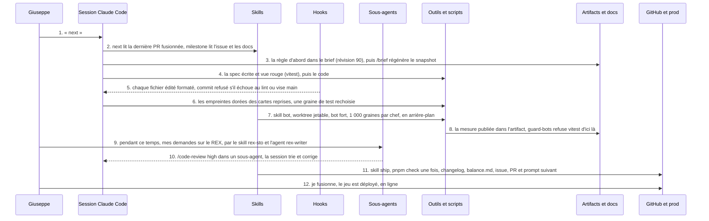

Le pari tenait en une phrase : un seul humain joue le *Product Owner*, le *reviewer* et le testeur, et **l'agent écrit tout le code**. Pas une ligne de moi. La question n'était pas « *est-ce que l'IA sait coder* » (on le sait), mais : est-ce que ça tient sur un vrai produit, pendant plus de trois jours, sans que la qualité s'écroule ? Et surtout, quelle organisation il faut autour pour que ça tienne.

Le produit, c'est *Salade Tomate Oignon*, un *deckbuilder roguelite* dans le navigateur où vous reprenez un kebab en déclin. Il m'a servi de fil rouge ; il n'est pas le sujet. Le sujet, c'est **tout ce qui entoure le code** : le brief, les règles, les skills, les hooks, les procédures de PR. Ce que j'appelle, comme en cuisine, la *mise en place*.

Les chiffres, lus dans le dépôt le 26 octobre :

- 9 jours, du 18 au 26 octobre 2026 ;
- 93 pull requests fusionnées ;
- 571 commits sur `main` ;
- 1 087 tests dans 98 fichiers de spec ;
- 18 377 lignes de TypeScript hors tests, et 16 856 lignes de tests ;
- 88 sessions Claude Code.

Rien n'est arrondi vers le haut, sauf mon ego. Le jeu est en ligne depuis le troisième jour, en français, en anglais et en italien, et il reste privé : vous n'aurez que des captures.

<Figure src="{BASE_URL}/imgs/articles/2026-10-27-workflow-claude-code-kebab-roguelite/service.png" alt="L'écran de service du jeu en pixel art, thème nuit : la cliente Nadia, son contrat affiché, une main de six cartes-ingrédients et le kebab en cours" caption="Le service, thème nuit. Nadia prend le train dans quatre minutes." />

## Un kebab, des règles écrites noir sur blanc

Le jeu en cinq lignes. Une *run*, c'est trois quartiers de huit nœuds. Un nœud « service » fait défiler trois à cinq clients ; pour chacun, vous composez un kebab avec une main de six cartes-ingrédients (un pain obligatoire, puis viande, garnitures, sauces, un extra) et vous le servez contre le *contrat* du client : un seuil, des exigences fermes, des tags préférés, une patience. Le *loyer* tombe à la fin de chaque quartier. Réputation à zéro ou loyer impayé : rideau.

**Trois choix font que c'est ce jeu-là** : la *broche* est la vie de la run (chaque carte viande mange une tranche), le client est un contrat lisible (rien de caché, la difficulté vient de la main), et le loyer est le boss économique.

Les contraintes que je me suis données :

- *mobile first* à 360 px, jouable au pouce, sans survol obligatoire ;
- *bundle* initial sous 250 kB gzip ;
- aucune requête réseau en jeu ;
- pas de framework CSS, pas de compte, pas d'API externe ;
- clavier complet, contraste AA, `prefers-reduced-motion` respecté.

Et une règle de langue : **le jeu parle français, le code parle anglais**. La stack, choisie avant la première ligne : React 19, TypeScript strict, Vite, Zustand, Motion, Vitest, ESLint et Prettier, GitHub Actions.

Tout ça vit dans un document, « *Kebab Roguelite — Brief de jeu* » : pitch, boucle, règles numérotées, contenu, stack, questions ouvertes. **C'est la source de vérité.** Le dépôt n'en lit qu'un instantané généré, `docs/brief.md`, avec son numéro de révision en tête (90 aujourd'hui) ; une commande `/brief` le régénère. Une règle change d'abord dans le brief, puis dans le code, *jamais l'inverse*.

Et le brief contient un exemple chiffré, un client nommé Karim servi pour un score de 15 : **c'est le test de régression de référence**. Quand le modèle de score a changé le 23 octobre, la décision a été « *Karim reste à 15* », et le test est resté le juge.

<Figure src="{BASE_URL}/imgs/articles/2026-10-27-workflow-claude-code-kebab-roguelite/map.png" alt="La carte d'un quartier en pixel art : huit rangées de nœuds reliés par des chemins, le boss en haut, puis le loyer" caption="La carte d'un quartier : 8 rangées, le boss, puis le loyer." />

## La mise en place : écrire ce qu'un collègue aurait deviné

Le principe est simple : **l'agent code, je décide**. Pour que ça marche, il a fallu écrire noir sur blanc tout ce qu'un collègue humain aurait deviné en deux jours de *pair programming*. Voici les pièces, dans l'ordre où elles sont arrivées.

**Le brief et son snapshot.** Je viens d'en parler. Ce qui compte, c'est qu'un agent qui repart de zéro à chaque session a besoin d'un texte qui **ne bouge que par décision**. Sans ça, il « corrige » le jeu vers ce qu'il croit que le jeu devrait être.

**Le glossaire.** `docs/glossaire.md` : un terme français, un identifiant anglais, un sens. Une fonction du moteur dont le nom n'y est pas est renommée, ou le glossaire grandit d'abord. Sans table, chaque session invente son mot (`queue` ou `line`, `district` ou `neighborhood`) et **le code se remplit de synonymes**. Il a aujourd'hui 471 lignes, une colonne anglaise et une italienne : c'est lui qui a servi de lexique quand le jeu a été traduit.

**Un `CLAUDE.md` court.** C'est le fichier que l'agent lit à chaque session. Le mien ne décrit pas le code (le code le dit mieux) : il dit **où est la vérité et ce que le code ne peut pas dire**. Un extrait, tel quel :

```md
Topic rules live in `.claude/rules/` and load when you touch matching files (engine and content,
components and styles, stores, tests, CI). Don't inventory the code here or there: write only what
the code can't tell.

- **Words:** `docs/glossaire.md` maps each French term to its one English identifier. An engine
  function whose name isn't in it gets renamed, or the glossary grows first.
- **Balance:** `docs/balance.md` logs every value change (date, before, after, why).
```

**Des règles par dossier.** Cinq fichiers dans `.claude/rules/`, lus seulement quand l'agent touche les fichiers qu'ils visent :

- le moteur est un réducteur pur et semé, le contenu est de la donnée ;
- les stores ne portent aucune règle de jeu ;
- les composants lisent des sélecteurs ;
- la spec s'écrit d'abord et se montre rouge ;
- la CI fait ce que fait `pnpm check`, en un job.

**Le TDD imposé, pas suggéré.** La spec d'abord, montrée rouge, puis le code. Chaque règle numérotée du brief a un test qui porte son nom. Couverture de 90 % exigée sur le moteur depuis le jour 1, jamais abaissée. Le rouge montré avant le code est la seule preuve que le test teste quelque chose, et c'est encore plus vrai avec un agent : **le test est la seule spécification qu'il ne peut pas interpréter**.

**Les skills.** Les procédures vivent dans `.claude/skills/`, pas dans ma tête.

- `/milestone N` atterrit la PR fusionnée et démarre la suivante ;
- `/next` lit la dernière PR pour savoir quoi faire ;
- `/ship` relit le diff avec `/code-review`, lance le check complet une seule fois, met à jour le changelog, coche les cases de l'issue et ouvre la PR ;
- `/brief` régénère le snapshot ;
- `/bot` mesure l'équilibrage.

Une procédure dans un fichier **se corrige une fois pour toutes les sessions** ; un rappel dans un prompt s'oublie à la troisième.

**Les hooks.** Cinq garde-fous **exécutés par l'outil, pas par la bonne volonté** :

- formater et linter chaque fichier édité ;
- refuser un commit sur `main`, un push dessus et tout *force push* ;
- refuser un commit dont les fichiers échouent à Prettier ou ESLint ;
- refuser le check complet, vitest et les captures tant qu'un bot d'équilibrage tourne ;
- et dire au démarrage de chaque session ce qui tourne déjà.

**Le prompt de la prochaine session.** Chaque PR se termine par un bloc de texte que la session suivante copie-colle : le jalon, les cases qu'elle prend, les pointeurs. Les décisions prises hors du brief sont dans une section « Décisions » du corps de la PR, que `/milestone` relit. C'est **le passage de relais entre deux contextes vides** : le mot laissé sur le comptoir pour l'équipe du soir.

**Les bots.** Dès le premier jour, un bot joue des milliers de services pour mesurer chaque réglage ; le 23 octobre arrive le *bot fort*, qui essaie tous les kebabs légaux de la main et tient lieu de joueur expérimenté. Chaque ligne de `docs/balance.md` dit avant, après, pourquoi, et le taux mesuré. **Sans ça, l'équilibrage est une opinion.**

En un coup d'œil, voilà où vit chaque pièce dans le dépôt :

```text
salade-tomate-oignon/
├─ CLAUDE.md            la direction, les documents de référence, le workflow ; lu à chaque session
├─ CHANGELOG.md         un bloc par jalon, « Outillage » pour la mise en place
├─ .claude/
│  ├─ settings.json     l'allowlist des commandes permises et le branchement des hooks
│  ├─ rules/            lues seulement quand on touche les fichiers qu'elles visent
│  │  ├─ engine.md      réducteur pur, rng semé, le contenu est de la donnée
│  │  ├─ stores.md      trois stores, aucune règle de jeu
│  │  ├─ components.md  des sélecteurs, pas de règle en composant
│  │  ├─ testing.md     la spec d'abord, montrée rouge
│  │  └─ ci.md          check.yml fait ce que fait pnpm check, en un job
│  ├─ skills/           les procédures qu'on invoque
│  │  ├─ milestone/     atterrir la PR fusionnée, lire l'issue, brancher, plan, test d'abord
│  │  ├─ next/          prendre le jalon et les cases dans le prompt de la dernière PR
│  │  ├─ ship/          /code-review, un seul pnpm check, changelog, issue, PR et prompt suivant
│  │  ├─ brief/         comparer la révision du doc, régénérer docs/brief.md
│  │  └─ bot/           mesurer, et garder chaque mesure
│  └─ hooks/            ce que l'outil exécute, sans demander
│     ├─ lint.mjs             PostToolUse : formate et lint-fixe le fichier édité
│     ├─ guard-main.mjs       PreToolUse : refuse commit et push sur main, tout force push
│     ├─ check-commit.mjs     PreToolUse : refuse un commit qui échoue à Prettier ou ESLint
│     ├─ guard-bots.mjs       PreToolUse : refuse check, vitest et captures pendant un bot
│     └─ session-context.mjs  SessionStart : les bots en cours, les dernières mesures
├─ docs/
│  ├─ brief.md          le snapshot généré du brief, sa révision en tête ; jamais édité à la main
│  ├─ maquettes.md      la direction pixel art zone par zone
│  ├─ glossaire.md      un terme français, un identifiant anglais, un sens
│  └─ balance.md        chaque valeur changée : date, avant, après, pourquoi, taux mesuré
└─ scripts/             bot.ts (refuse au-delà de 1 000 graines), screenshots.ts, brief-to-md.mjs
```

## Une demande type, de « next » au jeu en ligne

Pour voir ce que ça donne en vrai, prenons la PR 117 du 26 octobre, « la place des marchés et des pauses sur la carte ». Douze étapes, de « next » au jeu en ligne. **Je n'y apparais que trois fois** : au début, en parallèle, et au merge. Le reste, c'est l'outillage qui appelle l'outillage.



Quelques détails qui comptent.

- À l'étape 3, la règle est entrée dans le brief *avant* d'entrer dans le code : le marché ne tombe qu'aux rangées 4 à 7, la pause aux rangées 3 à 7.
- À l'étape 4, la spec a été écrite et vue rouge sur 1 000 graines avant la première ligne du moteur.
- À l'étape 7, la mesure au bot fort a tourné dans un *worktree* jetable pendant que la session continuait, et le hook `guard-bots` a refusé tout `vitest` jusqu'à la fin.
- À l'étape 10, la revue automatique à niveau `high` a fait appliquer trois corrections et en a laissé deux, avec le pourquoi dans le corps de la PR.

Et la PR se termine par le prompt de la session suivante, qui dit déjà ce que sera la PR d'après : le loyer. Dans le dépôt comme dans le jeu, il finit toujours par tomber.

Ce que je retiens de cette séquence : chaque flèche qui ne part pas de moi est **une décision que j'ai prise une fois, puis rangée dans un fichier**.

## L'échelle de persistance

C'est **la leçon la plus transférable** de ces neuf jours. Chaque correction du workflow a monté d'un cran l'endroit où la décision est rangée :

1. une phrase dans le chat : perdue à la session suivante ;
2. une ligne dans `CLAUDE.md` ou une mémoire persistante : lue, parfois ;
3. une règle par dossier : lue quand on touche le dossier ;
4. un skill : une procédure qu'on invoque ;
5. un hook : une règle que l'outil exécute, sans demander ;
6. le script lui-même : il refuse, quoi qu'on lui dise.

**Plus l'oubli d'une décision coûte cher, plus elle doit descendre dans cette échelle.**

Exemple vécu, le 26 octobre à 10 h 52 : « *fini les runs à 2 000, le max doit être 1 000 ; ajuster le flow pour que ça prenne place le plus tôt possible, et faire persister cette préférence* ». Les mesures à 2 000 graines prenaient une heure par chef et bloquaient la machine. Dans la matinée, le plafond a parcouru toute l'échelle : dans la mémoire persistante, dans le skill `/bot`, dans le changelog, et dans `scripts/bot.ts` lui-même, qui refuse au-delà de 1 000. **Le prompt s'use ; le script, non.**

Un hook, concrètement, c'est un script que Claude Code exécute avant ou après un appel d'outil, et qui peut refuser l'appel. Voici la fin de `guard-main.mjs`, celui qui garde `main`, tel quel :

```js
  const verb = words[at];

  if (verb !== 'commit' && verb !== 'push') continue;

  const checkout = dir ? pathOf(dir) : cwd;

  if (!inProject(checkout)) continue;
  if (verb === 'push' && /(--force\b|--force-with-lease\b|\s-f\b|\s\+\S)/.test(rest)) {
    deny('Force pushes are not used in this repo: rebase locally, then push a new branch or PR.');
  }
  if (verb === 'push' && /(\s|:|refs\/heads\/)main(\s|$)/.test(rest)) {
    deny('This push targets main: main only moves by merged PR.');
  }

  if (git(checkout, ['rev-parse', '--abbrev-ref', 'HEAD']) === 'main') {
    deny(
      'The checkout is on main. Create the branch first (git switch -c milestone-N/<slug>) ' +
        'and commit there; main only moves by merged PR.',
    );
  }
```

Le message de refus est lu par l'agent, qui **corrige tout seul** : il crée la branche et recommence. Ce hook a lui-même été relu par `/code-review` le premier jour, qui y a trouvé deux trous (un `cd ~` mal résolu, le mot « commit » pris pour la sous-commande dans un message), et il a été resserré le 21 octobre, quand il s'est mis à garder tous les dépôts de la machine au lieu du seul dépôt du jeu.

<Reminder variant="tip" title="Par quoi commencer">

Trois hooks suffisent pour le premier jour : formater le fichier qui vient d'être édité, refuser un commit sur `main`, refuser un commit dont les fichiers échouent au lint. Les deux autres (le garde des tâches lourdes, le contexte de session) sont nés d'incidents : attendez les vôtres.

</Reminder>

## Monté, audité, corrigé en même temps que le jeu

Les skills, les hooks et les règles n'étaient pas là le premier matin par magie. Ils ont été montés, audités et corrigés pendant les neuf jours, en parallèle du jeu, par les mêmes sessions : 32 commits touchent `.claude/` ou `CLAUDE.md`, et douze PR ne contiennent pas une ligne de jeu. Quatre phases, avec les vraies dates, parce que c'est précisément le point : **tout ça tient dans la même semaine que le jeu**.

**Phase 1, l'ouverture, le 18 octobre, en une matinée.** 10 h 26, le socle. 11 h 44, la première PR d'outillage : le snapshot généré du brief et `/brief`, `/milestone` et `/ship`, le hook qui refuse les commits sur `main`, un `CLAUDE.md` réorganisé autour des documents de référence. 13 h 33, une seconde PR : une PR par groupe de cases au lieu d'une par jalon, le mode plan avant le premier test rouge. Le moteur n'était pas encore fusionné.

**Phase 2, les garde-fous, du 19 au 22 octobre, un incident à la fois.** Le 19, une PR arrive en CI non formatée (un fichier modifié depuis le shell échappe au hook de format) ; le jour même, un hook refuse tout commit dont les fichiers échouent à Prettier ou ESLint. Le 21, le garde de `main` suivait les `cd` dans n'importe quel dépôt et a refusé un commit ailleurs : il ne garde plus que ce dépôt. **De la maintenance, pas de la revue.**

**Phase 3, l'audit, les 23 et 24 octobre.** Le 23, une spec dite « *minimale* » jouait une run entière du bot fort ; la règle de test dit désormais qu'une telle spec joue une ou deux runs, et que les taux se mesurent avec `pnpm bot`.

Le 24 à 16 h 32, je découvre qu'une session s'apprête à relancer deux heures de bot dont le résultat dormait dans le dossier temporaire d'une autre. À 19 h 06, une consigne d'une ligne : « *profite pour revoir toute l'automatisation du flow Claude ; spawn un agent spécialisé pour faire la critique. Je travaille seul sur ce repo.* » Un agent critique relit tout l'outillage, et le soir même, en une PR : le skill `/bot` et un artifact qui garde chaque mesure pour ne jamais en relancer une déjà faite, le hook qui refuse le check et vitest pendant un bot, le hook qui dit au démarrage ce qui tourne déjà, un seul `pnpm check` par PR après `/code-review`, et un `CLAUDE.md` rattrapé.

**Phase 4, l'industrialisation, les 25 et 26 octobre.** La décision va dans l'outil, *pas dans le prompt* : une mémoire persistante dit à toute session que les traductions arrivent (les valeurs séparées des mots, les pluriels dans le contenu) ; un garde refuse les imports relatifs ; le plafond des graines descend jusqu'au script.

Ce que je paie encore aujourd'hui, c'est que l'audit n'a eu lieu que le septième jour. L'agent critique du 24 a trouvé en un soir ce que les incidents de la semaine m'avaient coûté en sessions. **Un audit du workflow le deuxième jour aurait été rentable dès le troisième.**

## Ce que le workflow ne fait pas

Tout ce qui précède produit du code de qualité à une vitesse que je n'avais jamais vue. **Il ne produit pas l'usage.** Quatre limites, vécues.

**Tout vert, et « *presque injouable* » sur téléphone.** 1 087 tests, une couverture de 90 %, des captures à 360 px à chaque PR, Lighthouse surveillé. Et le 26 au matin, ma première vraie partie au pouce : en mode défausse, chaque *tap* défausse tout de suite et la main se recompacte, donc le tap suivant tombe sur une autre carte ; après « Servir », le bouton du client suivant arrive sous le doigt qui vient de servir. **Les tests vérifient ce qu'on leur a dit de vérifier.** Personne ne leur avait dit « *le doigt ne bouge pas entre deux taps* ». La seule mesure qui compte pour un jeu mobile, c'est un pouce sur un téléphone, et je l'ai faite trop tard et trop peu.

**Un bug qui n'existe qu'en production.** En prod, les feuilles de style des chunks chargés paresseusement arrivent avant `index.css` : l'ordre des `@layer` s'inverse, `base` bat `components`, et le logo du bandeau devient brun sur brun, une couleur très correcte pour une sauce, moins pour un logo. Le serveur de dev et le script de captures gardent le bon ordre, donc tout le pipeline de preuve était aveugle. **Les captures doivent se prendre sur le *build*, pas sur le *dev server*.**

**L'agent est sûr de lui, surtout quand il a raison à 90 %.** Une migration de sauvegarde qui « *tient* », une politique de bot « *rééquilibrée* », une spec « *minimale* » qui joue une run entière : chaque fois, le ton est le même. La revue automatique, le TDD et les bots corrigent une partie ; le reste, c'est à moi de **douter au bon endroit**, et le bon endroit n'est pas toujours là où l'agent hésite. Quand il dit « *minimal* », vérifiez la durée. Quand il dit « *tient* », vérifiez la migration. Quand il dit « *c'est prêt* », goûtez.

**La charge de revue ne disparaît pas, elle se déplace.** Je n'écris plus le code, mais je lis 93 PR, j'arbitre chaque section « Décisions », je relis le brief à chaque révision, je joue le produit. C'est un travail de PO à temps plein, pas une sieste. Un développeur qui croit qu'il va « *juste prompter* » découvre qu'il est devenu le goulot. Et **dire non est devenu la compétence rare** : tout ce qu'on accepte devient une PR, un changelog, une révision du brief.

<Figure src="{BASE_URL}/imgs/articles/2026-10-27-workflow-claude-code-kebab-roguelite/wedding.png" alt="Le boss du mariage en pixel art : cinq invités à servir avec le même menu, le seuil qui monte à chaque kebab" caption="Le mariage : cinq invités, le même menu, le seuil qui monte. Les bots ont montré pourquoi il était injouable, et une décision l'a réglé." />

<Reminder variant="warning" title="Les tests verts ne sont pas une acceptation">

L'acceptation, c'est l'usage : un pouce, un téléphone, une personne qui n'a pas lu les règles. Et la preuve se prend sur l'artefact livré : le build de production, un vrai appareil. **Le dev server ment par omission.**

</Reminder>

## Si vous voulez essayer

**Quand c'est la bonne façon de travailler.** Un produit dont le domaine s'écrit noir sur blanc (règles, invariants, exemples chiffrés), un cœur de métier testable sans UI, et **un responsable produit disponible pour décider tous les jours**. Un *greenfield*, une réécriture isolée, un outil interne, un prototype qu'on veut pousser jusqu'à la prod. Moins bonne quand le domaine est dans la tête de trois personnes qui ne se parlent pas, ou quand la preuve d'acceptation est un usage qu'on ne peut pas reproduire chez soi.

**Par quoi commencer.** *Pas par le code.* Par un brief d'une dizaine de pages avec des règles numérotées et un exemple de référence (votre Karim à 15). Puis un `CLAUDE.md` court qui dit où est la vérité et ce que le code ne peut pas dire, des règles par dossier, trois hooks (format, pas de commit sur `main`, pas de commit qui échoue au lint) et une procédure de PR dans un skill. Le premier jalon est le socle et la première règle testée : **si l'exemple de référence n'est pas vert à la fin du jour 1, le brief n'était pas prêt**.

**Les pièges.**

- Croire que les tests remplacent l'usage.
- Laisser l'agent décider d'une règle métier « en passant ».
- Accepter tout ce qui est proposé parce que c'est bien fait.
- Faire une grosse PR parce que l'agent va vite : la revue automatique est bonne sur un petit diff et médiocre sur un gros.
- Lancer une tâche lourde sans savoir ce qui tourne déjà.
- Garder une décision dans le chat.

J'ai testé chacun d'eux pour vous, certains plusieurs fois.

**Le workflow est un lot.** Sur une mission, l'outillage (le `CLAUDE.md`, les règles, les skills, les hooks, l'*allowlist* des permissions) **se traite comme du code** : dans le dépôt, avec sa section de changelog, ses PR relues, et une revue par semaine par un agent critique à qui on dit qui travaille dessus et comment. Chaque incident de session est un ticket d'outillage, et sa correction va le plus bas possible dans l'échelle : une règle, un skill, un hook, le script.

Ici, 32 commits et douze PR en neuf jours ; c'est le prix d'un workflow qui tient, et il est petit à côté des 93 PR qu'il a portées. Les deux rôles, dev et PO, peuvent être une seule personne un temps ; sur une mission, ce sont deux personnes, et **le PO n'est plus optionnel**.

## Conclusion

En neuf jours, un développeur seul et un agent ont livré un jeu complet, traduit, déployé et équilibré au bot, avec une discipline de PR et de tests qu'on n'obtient pas toujours à cinq ; et ils ont monté la mise en place en même temps que le plat. Le même matin, le même jeu s'est révélé presque injouable au pouce, là où il devait être le meilleur. Les deux sont vrais, et c'est tout le retour d'expérience : **la méthode produit du code de qualité à une vitesse inédite, et elle ne produit pas l'usage**. L'usage, il faut aller le chercher soi-même, avec un téléphone, tôt et souvent.

Si vous ne retenez qu'une chose : **l'agent est un excellent cuisinier qui ne sort jamais de la cuisine**. Il vous faut quelqu'un au comptoir, qui regarde la tête du client. *Salade, tomate, oignon ? Sauce roguelite.* Le code, c’est l’agent qui l’a écrit ; le kebab, c’est moi qui l’ai mangé.

## Ressources

- [La documentation de Claude Code](https://code.claude.com/docs/)
- [La mémoire et les fichiers `CLAUDE.md`](https://code.claude.com/docs/en/memory)
- [Les skills](https://code.claude.com/docs/en/skills)
- [Les hooks : le guide](https://code.claude.com/docs/en/hooks-guide) et [la référence](https://code.claude.com/docs/en/hooks)
